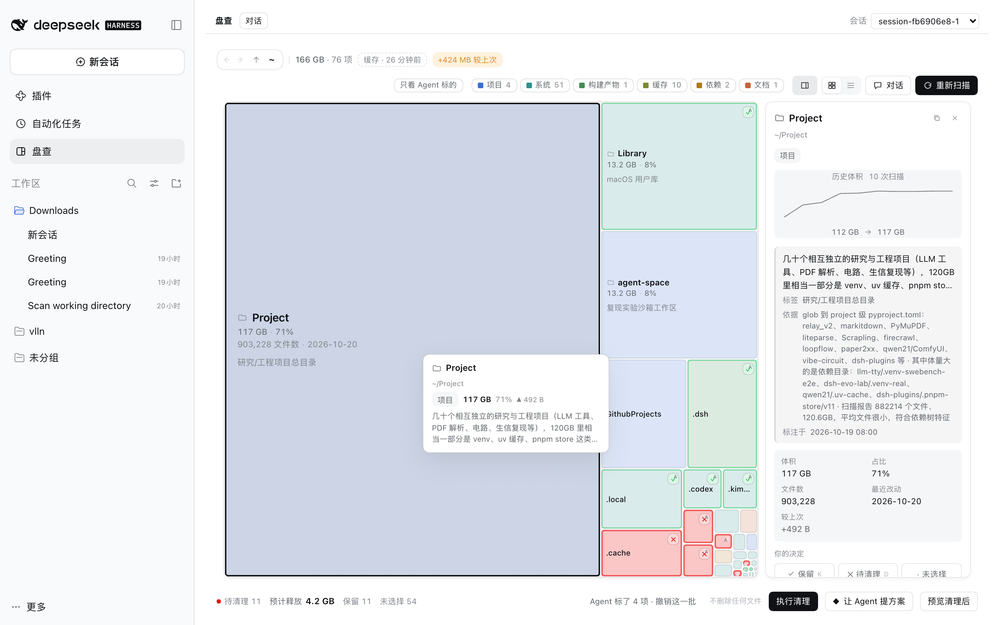
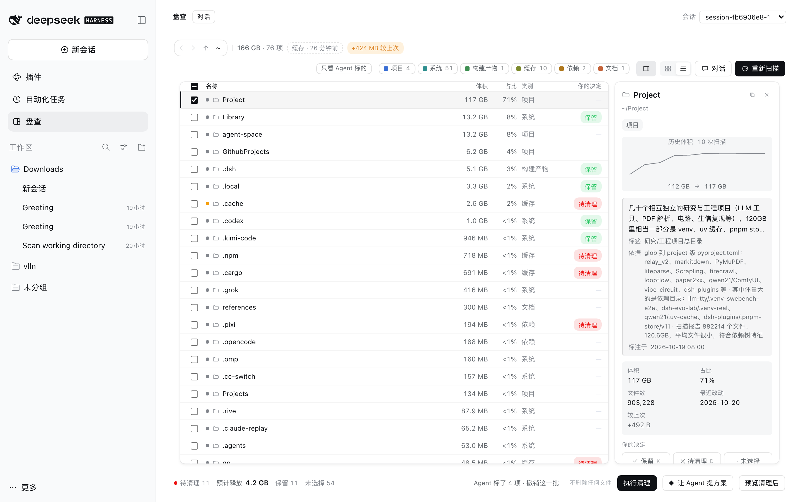
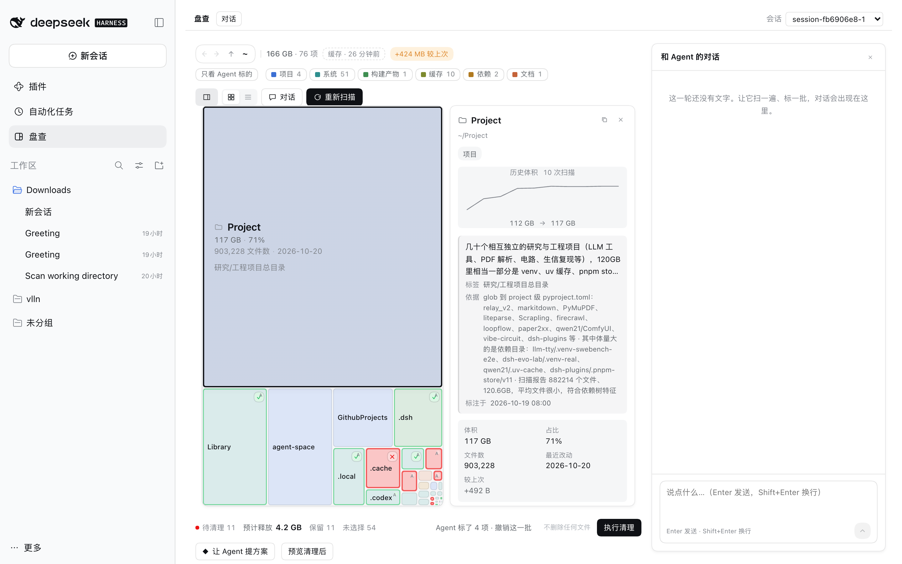

# 盘查 · Pancha

> 把磁盘变成一张可审查、可批注、可执行的盘面。 —— DeepSeek Harness 插件

Finder 告诉你「哪个文件夹大」，但不告诉你「它是什么、删了会怎样」。
盘查把磁盘画成一张**盘面**：每个方块按体积占位、按 Agent 给出的类别着色，点开有判断和依据；
你的决定（保留 / 待清理）直接标在方块上，清理**执行前**逐项预览，执行后可整批撤销。



## 它解决什么

- **看**：树图看「哪里大」，列表逐项过，历史体积曲线看「它在长还是在缩」。
- **懂**：Agent 为每个目录写一句语义（是什么、能不能删、依据是什么），类别固定九类。
- **定**：你按 `K` / `D` / `空格` 做决定，方块立刻变样；决定是唯一会被「执行」的东西。
- **执行**：待清理项先预览（冲突逐项标出），确认后移到废纸篓；系统废纸篓没权限时退到插件回收目录，仍可撤销。



## 安装

```sh
dsh plugin --profile web add github:vlln/dsh-pancha
# 或本地包：
dsh plugin --profile web add ./dsh-pancha-3.0.0.tgz
```

装完刷新页面。升级：把 `add` 换成 `dsh plugin --profile web update dsh-pancha`。

- 需要 dsh `0.2.x`（在 `0.2.1-rc.1` 上验证）。
- 工具注册在默认会话上，不新增模式、不需要选 preset。

## 用起来

1. 左侧栏点 **盘查**。第一次打开会自动建一个**一次性会话**（不挂工作区，所以不会出现在左侧列表），
   画布右上角可以换成别的会话。
2. 点 **重新扫描**（或首次自动扫主目录），等方块出现。
3. 扫完会自动请 Agent 补语义；也可以点 **让 Agent 提方案** 让它挑一批待清理的项。
4. 点方块看详情：类别、语义、依据、历史体积、你的决定。
5. 标好之后点 **执行清理**：预览 → 执行 → 可撤销。

### 入口与对话

- 画布是独立页面，从左侧栏 **盘查** 进入；不再占用会话页签。
- 右上角 **对话** 打开抽屉，直接和绑定的会话说话：消息按角色分栏、Assistant 回复渲染 Markdown、
  运行中有状态提示。发出去的话会自动带上画布约束。



## 键盘

| 键 | 作用 |
|---|---|
| `K` / `D` | 保留 / 待清理（再按一次取消） |
| `空格` | 循环：未选择 → 待清理 → 保留 → 未选择 |
| `← ↑ ↓ →` | 在方块间移动选中 |
| `Esc` | 取消选择 |
| `Backspace` / `0` | 清除选中项的决定 |

## Agent 能力

| 工具 | 作用 |
|---|---|
| `disk_canvas_scan` | 扫描目录（默认主目录），返回体积最大的若干项与 pending |
| `disk_canvas_state` | 读当前盘面：计划、条目、你的决定；`wait:false` 可在扫描中读 |
| `disk_canvas_claim` | 写一条语义（一句话 + 类别 + 依据），不执行任何删除 |
| `disk_canvas_mark` | 直接标一批决定（和用户按键同一份数据），只补没决定的 |
| `disk_canvas_object` | 对已有决定写一句异议，不改决定 |
| `disk_canvas_history` | 读账本历史与增量 |

约束来自投递消息里的提示词：**只分析、标注、预览，不直接改动文件**。这是软约束——
默认会话本身仍有文件/命令工具。要工具级隔离，需要自己加一个受控 preset。

## 数据与隐私

- 账本：`$DSH_HOME/data/dsh-pancha/ledger.json`（原子写、debounce）。存扫描快照、决定、Agent 语义、
  历史与执行台账；只在本机，不上传。
- 扫描：只读 `readdir`/`stat`，不跟随符号链接，不改文件。
- 执行清理：移动到 `~/.Trash`；被 macOS TCC 拒绝（EPERM）时退到 `$DSH_HOME/trash/<时间戳>/`，
  界面会写明去向。不提供「清空废纸篓」。
- 迁移：旧版 `data/dsh-disk-canvas` 会在启动时自动认领到新目录。

## 设计 token

`.dc-root` / `.dc-home` 上定义整套颜色、形状、时长；组件只引用不发明。改风格只改那一层：

- 类别色板 `--dc-hue-0…7`，色号按「类别第一次出现」分配并落账本，跨会话稳定；
- 决定色 `--dc-mark-keep/delete`，饱和色只给决定；
- 三张卡片（画布 / 检查器 / 对话）共用 `--dc-card-r`、`--dc-card-line`、`--dc-card-shadow`。

## 限制

- 扫描只读**当前层的直接子项**，逐层下钻；不建全盘索引。
- 执行只做「移到废纸篓」，没有重命名 / 归档 / 压缩。
- 废纸篓权限随宿主环境而异；被拒时走插件回收目录。
- Agent 语义是「一句结论 + 依据」，不保证正确，决定权在用户。

## 开发

```sh
npm test                              # 44 项单测（node --test）
npm_config_cache=/tmp/dc-npm-cache npm pack   # 产出 dsh-pancha-x.y.z.tgz
```

```
index.mjs             宿主半：扫描、路由、工具、会话投递
lib/client.js         客户端半：盘面、检查器、对话抽屉、样式
lib/src/*.mjs         扫描、账本、语义、规则、移动
tests/*.test.mjs      单测
docs/contract.md      稳定面契约（HTTP / 工具 / 数据形状）
```

## 许可

MIT
