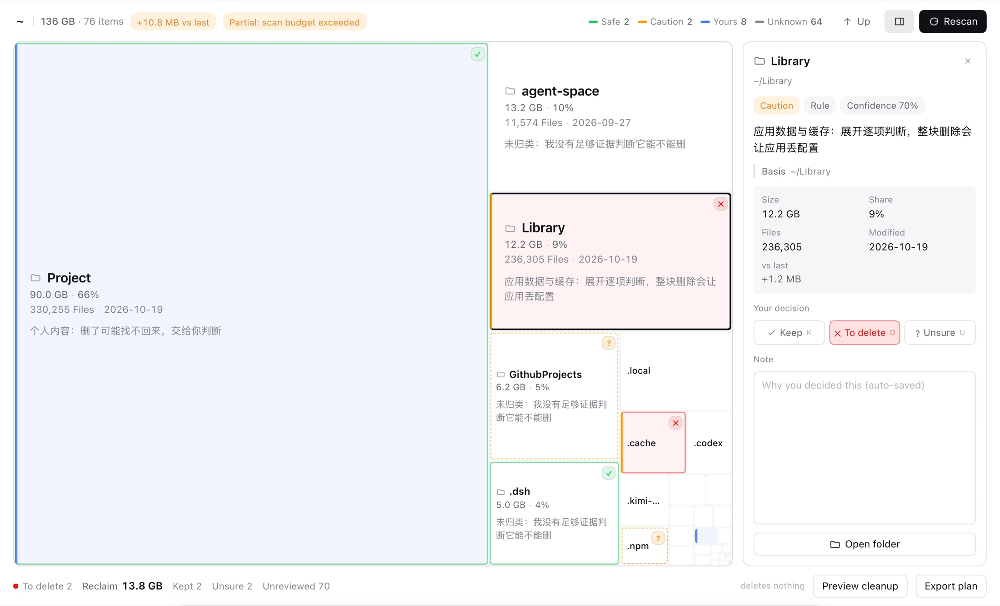

# dsh-disk-canvas

> 把磁盘扫成一张可批注的提案：Agent 标注、你来决定、删前可预览。（DeepSeek Harness 插件）

你在 Finder / SpaceSniffer 里能看到「哪个文件夹最大」，但看不到「它是什么、删了会怎样」。
这个插件把磁盘变成一张**画布**：每个方块按体积占位、按风险上色，点开有判断和依据；
你的决定（保留 / 待清理 / 待复查）直接标在方块上，汇总成一份可导出的计划。



**它不删文件。** v0 只做分析与预览，执行权始终在你手里。

## 安装

```sh
dsh plugin --profile web add github:vlln/dsh-disk-canvas
```

装完刷新页面。升级：把上面的 `add` 换成 `dsh plugin --profile web update dsh-disk-canvas`。

- **画布入口**：会话页签里的 **磁盘画布**（与「对话」「轨迹」并排）。
- **整理模式**：新建任务时在模式选择器里选 **磁盘整理**——这个 preset 自带提示词与
  `disk_canvas_*` 工具，其它模式看不到这些工具。
- **前置**：macOS + dsh `0.2.1-rc.1` 或兼容的 0.2.x。

## 两种用法

| 用法 | 入口 | 你能做什么 |
|---|---|---|
| 看与批注 | 任意会话 → **磁盘画布** 页签 | 树图、检视器、保留/待清理/待复查、预览、导出 |
| 让 Agent 参与 | 新建任务 → 模式选 **磁盘整理** | Agent 用 `disk_canvas_scan` / `state` / `claim` 扫描与标注，你在画布上改 |

页签与工具是分开的：画布在哪种模式都能打开（它只是数据视图），工具只在「磁盘整理」模式下挂载。

## 用起来

| 你做什么 | 画布给你什么 |
|---|---|
| 打开「磁盘画布」页签 | 主目录的第一层，按体积排的树图；左侧色条 = 风险（安全 / 谨慎 / 个人 / 未知 / 高危），标题行右侧是图例与各档数量 |
| 点一个方块 | 右侧检查器：这是什么、为什么、依据与把握、体积 / 占比 / 文件数 / 最近改动 |
| 双击目录方块 | 进入该目录（也可以点检查器里的「进入目录」） |
| 标一个决定 | 保留 / 待清理 / 待复查 + 一句备注；方块立刻变样（绿框 ✓ / 红底 ✕ / 黄虚线 ?） |
| 不选任何方块 | 检查器变成总览：审查进度、四档计数、按体积排的待审队列（点一行直接选中） |
| 点「预览清理后」 | 隐藏待清理块，看剩下的结构；**磁盘没有任何改动** |
| 点「导出计划」 | 一份 JSON：待清理清单、预计释放、你写的备注 |

备注**边写边存**（600ms 防抖），换方块也会先把没落盘的字写掉。右上角的检查器按钮可以收起，
收起后画布占满整宽——只想想看清楚结构的时候用它。

### 键盘

| 键 | 动作 |
|---|---|
| 空格 | 循环标记：无 → 待清理 → 保留 → 待复查 → 无 |
| K / D / U | 直接标：保留 / 待清理 / 待复查 |
| Backspace / 0 | 清掉选中项的决定 |
| ← ↑ ↓ → | 按方位在方块之间移动（不用鼠标也能一路审下去） |
| Enter | 进入选中的目录 |
| Esc | 取消选中；没选中时返回上层 |

标记直接画在方块上：保留是绿框 + ✓，待清理是红底红框 + ✕，待复查是黄虚线 + ?。
悬停 220ms 出信息卡；左上角路径的每一段都可以点回去。
颜色只用来表达语义（风险与决定），按钮和界面本身一律中性色——不然「蓝色」到底是个人内容还是主按钮，自己也说不清。

## 持久化与历史

扫描快照、你的决定、Agent 的标注都写在 `$DSH_HOME/data/dsh-disk-canvas/ledger.json`：

- 每根目录保留**最近 20 次扫描 / 90 天 / 总量 ≤ 5 MB**（只存顶层聚合，不存整棵树）；
- 重启 dsh 后画布用上次快照**秒开**，不会先重扫；点「重新扫描」才更新；
- 标注按路径全局保留，换目录、换会话、重启都还在；
- `disk_canvas_history` 让 Agent 读历史与增量（"这周哪个目录在涨"）。

扫描是插件的持久周期，会话只是某次审查；关掉会话不影响账本。

## 能力面

**Preset**

| 模式 | 说明 |
|---|---|
| 磁盘整理 | 自带提示词的磁盘审查 Agent：只分析、标注、预览；工具只有 `disk_canvas_*`，没有 shell / 删除能力 |

**Tools**（只挂在「磁盘整理」模式）

| 工具 | 说明 |
|---|---|
| `disk_canvas_scan` | 扫描一个目录（默认主目录）的直接子项，返回体积最大的若干项与规则标注 |
| `disk_canvas_state` | 读当前画布状态：计划、条目、你的决定 |
| `disk_canvas_claim` | 给某路径写一条判断（风险档 + 把握度），不执行删除 |
| `disk_canvas_history` | 读账本里的历史扫描与增量（最多 20 条） |

preset 里还有官方只读文件工具：`read` / `read_image`（`dsh-tool-fs` 关掉 write/edit）、
`glob` / `grep`（`dsh-tool-fs-search`）。**没有 shell、没有写/删工具**。

## 安全与数据

- **只读**：没有任何删除、移动、压缩接口；导出的计划由你自己执行。
- **本地**：扫描在宿主进程内完成，不发网络请求、不上传路径或清单。
- **落盘但只在本地**：扫描快照、决定与标注写在 `$DSH_HOME/data/dsh-disk-canvas/ledger.json`，不上传、不同步。
- **诚实**：没有证据的项标 `unknown`，不会把「不确定」包装成「安全」。
- **同源**：写面（scan / annotate）校验 `Origin` 与 `Host`，并限制请求体大小。

## 已知限制

- macOS 首版；Linux / Windows 未验证。
- 只扫当前一层（双击下钻）。首次扫描边扫边出（100 GB 级主目录约 15–60 秒），单个超大目录可能被条目/时间预算截断并标「部分结果」，不假装扫完。
- 不解析压缩包、虚拟机镜像、快照内部；容器只当普通文件。
- 「永久保留」目前是单次会话内的批注，不是跨会话规则（规则泛化在路线图上）。
- 规则推断基于路径与时间，不是文件内容；对未知目录保持沉默。
- 五档风险里 `personal`（个人内容）与 `unknown` 只是分类，不是「可删」；只有你标记的才算决定。
- 不提供回收站 / 隔离区 / 撤销——因为它们属于执行面，v0 刻意没有执行面。
- 历史只保留顶层聚合；要看更早的变化需要在账本上限内重扫。
- 画布面积严格等于体积：小项会小到不足 1 像素（真实主目录里 76 项有 42 项如此），
  它们点不到——右侧清单里都能选中。这不是 bug，是单层树图对「少量大项 + 长尾小项」的诚实表现。
- 批量框选、缩放动画、小项聚合还没做（下一轮）。

## 兼容性

| dsh 版本 | 状态 |
|---|---|
| `0.2.1-rc.1` | ✅ 已验证（2026-10-18，真实安装并启动 web profile；页签、preset、工具注册） |
| 其它 0.2.x | ⚠️ 未验证——升级 dsh 后若页签消失，多半是 `conversation.view` 槽名或 preset 字段变了 |

## 插件管理

装/卸/启停用官方 CLI：`dsh plugin --profile web add|remove dsh-disk-canvas`；已装插件在
**侧边栏 Plugins 页**里查看与配置（Settings 里的「插件」只是只读清单）。

## 许可

MIT。交互契约见 [docs/contract.md](docs/contract.md)。
